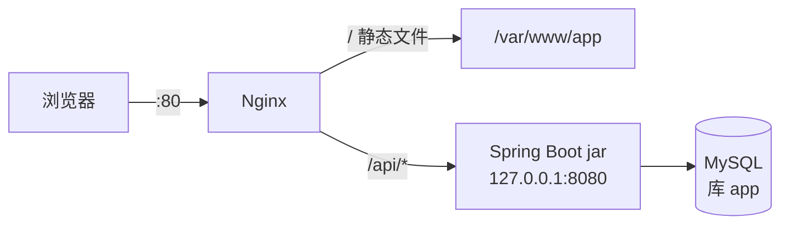

# 总体设计

## 技术栈

| 层 | 选型 |
|---|---|
| 前端 | React 19、TypeScript、Vite、pnpm |
| 后端 | Java 21、Spring Boot 4.0、MyBatis、Flyway、Lombok、Validation |
| 数据库 | MySQL 8.0（utf8mb4，时区 +08:00） |
| 运行环境 | 阿里云 ECS，Ubuntu 24.04，2 核 2G |
| Web 服务 | Nginx（静态资源、`/api` 反向代理、gzip） |
| 进程管理 | systemd（服务名 `app`，崩溃自动重启） |
| 持续集成 / 部署 | GitHub Actions |

## 仓库结构

```
miniteam-pms/
├── frontend/               前端工程
├── backend/                后端工程
│   └── src/main/resources/
│       ├── application.yaml
│       └── db/migration/   Flyway 建表脚本 V*.sql
├── docs/                   文档
├── .github/workflows/      format.yml、ci.yml、deploy.yml
├── AGENTS.md               AI 编程工具约定
└── README.md               组员上手说明
```

## 部署架构



| 组件 | 位置 |
|---|---|
| 前端构建产物 | `/var/www/app` |
| 后端 jar | `/opt/app/app.jar`，旧版本备份 `/opt/app/backup/`（保留 3 个） |
| 后端环境变量 | `/opt/app/app.env` |
| 后端监听 | `127.0.0.1:8080`，只经 Nginx 访问 |

## 环境

| | 开发 | 线上 |
|---|---|---|
| 前端 | `pnpm dev`，`localhost:5173`，`/api` 由 Vite 代理到 `localhost:8080` | Nginx 静态文件 |
| 后端 | IDEA 本机运行 | systemd 服务 `app`，profile `prod` |
| 数据库 | 服务器上的 `app_dev`（全组共用） | 服务器上的 `app`（仅本机访问） |
| 数据库密码 | `backend/application-local.yaml`（不提交） | `/opt/app/app.env` |

## 持续集成与部署

| 工作流 | 触发 | 内容 |
|---|---|---|
| `format.yml` 自动格式化 | 向 `main` 提 PR | Spotless 格式化 Java，有改动则提交 `style: 自动格式化` 到 PR 分支 |
| `ci.yml` 编译检查 | 向 `main` 提 PR | `backend`：Maven 打包；`frontend`：pnpm 构建 |
| `deploy.yml` 部署 | 合并到 `main`，或手动运行 | 构建前后端 → 上传 → 备份旧 jar → 重启 `app` → 检查服务状态 |

`main` 受保护，只能通过 PR 合并，`backend`、`frontend` 两项检查通过后才能合并。

## 接口约定

- 路径统一以 `/api` 开头。
- 响应体：`{ "code": 200, "message": "ok", "data": ... }`，出错时 `code` 非 200。
- 时间格式 `yyyy-MM-dd HH:mm:ss`，时区 Asia/Shanghai。

## 数据库版本管理

- Flyway 管理表结构，脚本 `backend/src/main/resources/db/migration/V序号__说明.sql`。
- 后端启动时自动执行未执行过的脚本，开发库与线上库结构一致。
- 已合并进 `main` 的脚本不再修改，改表新增下一个序号的脚本。
